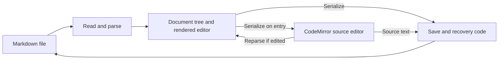

# Typora inspection and simpler-editor plan

Inspected October 13, 2026. Purpose: understand the supplied Typora installer well enough to plan Nick's own simpler Windows Markdown editor.

**Recommendation:** build a small independent application with Tauri 2, Milkdown rendered editing, and a CodeMirror 6 source view. Keep a single document window and one clearly labeled **Rendered / Source** switch. The main engineering work is preserving the document and making switching, undo, and saving predictable.

[Read the proposed build plan](DESIGN.md).

## What was actually inspected

| Item | Observed result |
|---|---|
| Supplied file | `C:\Users\NickKatsivelos\Downloads\typora-setup-x64.exe` |
| File size | 113,641,648 bytes |
| Product version | 1.14.10, in installer metadata and extracted application manifests |
| Signature | Windows Authenticode reported `Valid`; signer: Qiyun (Shanghai) Technology Co., Ltd. |
| Packaging | Inno Setup data identifies version 6.0.0; 32-bit setup launcher contains a 64-bit application |
| Extracted contents | 411 files, 405,346,306 bytes; these are extracted-file measurements, not an installed-footprint benchmark |
| Application shell | Electron; explicitly named in the bundled license. The packaged runtime `version` file reads `42.2.0` |
| Renderer | HTML/CSS plus a 1,713,530-byte JavaScript bundle, `resources/appsrc/window/frame.js` |
| Main-process entry | `launch.dist.js` loads V8 cached bytecode from `atom.compiled.dist.jsc` |

The installer and application were **not executed or installed**. No default-app setting or registry entry was changed. The original installer hash was checked again after analysis and is unchanged.

Installer SHA-256:

```text
2e2505e3a2bfdf9dea1b732a7bf7210873b9c841802a0d4c22b5bb75bf9ff7d4
```

Identity, signature and file hashes are saved in [provenance.json](C:/Users/NickKatsivelos/Downloads/typora-analysis/provenance.json). The complete extraction listing is [installer-inventory.txt](C:/Users/NickKatsivelos/Downloads/typora-analysis/installer-inventory.txt).

## What the editing code shows

The following are static code observations. They do not establish runtime performance or prove every branch executes in the shipped configuration. Line references point to a separately formatted copy of the shipped renderer, not recovered original development source.

| Finding | Evidence | Implication for a smaller editor |
|---|---|---|
| Rendered editing uses a structured document model, `NodeMap`, plus a separate undo manager. | [Editor construction](C:/Users/NickKatsivelos/Downloads/typora-analysis/derived/frame.pretty.js:26479) | Use an existing editor engine instead of rebuilding a custom document tree and editing system. |
| Source mode creates a separate CodeMirror editor on demand, configured for GFM. The source controller initializes `inSourceMode` to false. | [Source controller](C:/Users/NickKatsivelos/Downloads/typora-analysis/derived/frame.pretty.js:11531) | Two visible modes can share one document session; constructor defaults alone do not prove every startup path. |
| Markdown comes from CodeMirror in source mode and from `nodeMap.toMark()` in rendered mode. | [getMarkdown](C:/Users/NickKatsivelos/Downloads/typora-analysis/derived/frame.pretty.js:29310) | Conversion is part of the product, not merely a visual toggle. |
| Entering source mode synchronizes the current editor, obtains Markdown and fills CodeMirror. | [Entering source mode](C:/Users/NickKatsivelos/Downloads/typora-analysis/derived/frame.pretty.js:11839) | Convert only at a defined transition, after pending input is committed. |
| Leaving edited source on the Windows path calls `File.reloadContent()`; that resets the document tree, parses Markdown and rebuilds rendered HTML. | [Leaving source mode](C:/Users/NickKatsivelos/Downloads/typora-analysis/derived/frame.pretty.js:11935), [reparse](C:/Users/NickKatsivelos/Downloads/typora-analysis/derived/frame.pretty.js:38472) | Full-document conversion on switching is a reasonable first implementation; measure it before adding incremental synchronization. |
| CodeMirror history is cleared on entry. A source editing session can return to rendered history as a whole-document reload command. | [History reset](C:/Users/NickKatsivelos/Downloads/typora-analysis/derived/frame.pretty.js:11903), [reload transaction](C:/Users/NickKatsivelos/Downloads/typora-analysis/derived/frame.pretty.js:38451) | Cross-mode undo needs an explicit rule. Two libraries will not supply it automatically. |
| Cursor and viewport restoration use block identities, estimated source lines and syntax-specific mapping. | [Viewport anchor](C:/Users/NickKatsivelos/Downloads/typora-analysis/derived/frame.pretty.js:11849), [cursor restoration](C:/Users/NickKatsivelos/Downloads/typora-analysis/derived/frame.pretty.js:11991) | Preserve the user's place by document anchors; matching pixel scroll positions will not suffice. |
| The renderer contains CodeMirror's version string `5.26.0`. | [Version declaration](C:/Users/NickKatsivelos/Downloads/typora-analysis/derived/frame.pretty.js:65634) | This identifies a bundled declaration; it does not prove the bundle is an unmodified upstream release. Use a maintained editor for the new app. |

The inspected design can be summarized as:



The diagram expresses the inspected relationships; it is not a runtime trace.

## File handling is a substantial part of the application

The normal save path includes character encoding/BOM handling, validation, recovery, error reporting and post-write checks. See [saveUseNode](C:/Users/NickKatsivelos/Downloads/typora-analysis/derived/frame.pretty.js:33887).

The inspected writer serializes concurrent writes, uses a sibling temporary file, writes the destination and reads it back. Its asynchronous path should **not** be described as universally atomic: the implementation includes direct destination writes. A separate synchronous helper writes a temporary file and renames it. See [writer](C:/Users/NickKatsivelos/Downloads/typora-analysis/derived/frame.pretty.js:34312).

The renderer also contains filesystem-watcher paths and dispatches external changes to `File.presentedItemChanged()`. See [watcher code](C:/Users/NickKatsivelos/Downloads/typora-analysis/derived/frame.pretty.js:77316). Source exit and serialization explicitly handle line endings and final-newline policy. These mechanisms show that preservation matters; they do not prove byte-for-byte round trips.

For Nick's editor, save failure, unsaved changes, externally modified files and source preservation belong in the first working version. Folder libraries, diagram rendering, export systems and extensive preferences can wait.

## Coverage and limits

| Investigation question | Status |
|---|---|
| What package and application technology are present? | Answered from installer and extracted files. |
| How do rendered and source editing connect? | Answered for the inspected renderer paths. |
| What happens to undo, caret and scrolling? | Static mechanisms identified; user-visible behavior untested. |
| How are files saved and external changes detected? | Relevant renderer paths traced; full end-to-end behavior untested. |
| How does Windows launch/association registration work internally? | Partially answered: packaged Windows application identified; exact installer registry operations and bytecode entry-point dispatch were not recovered. |
| Can arbitrary Markdown round-trip without loss? | Unresolved; requires representative file tests in a running application. |
| Is the new implementation feasible with existing components? | Documentation-backed recommendation; no prototype has been built. |

REA parsed the launch JavaScript and renderer. The renderer's broad semantic graph exceeded its 1 GiB worker heap budget; retained syntax results are partial. Targeted manual inspection of the formatted code supplied the feature-path findings above. No negative conclusion relies on missing graph entries.

The main-process `.jsc` bytecode and `resources/node_modules/main.node` native module were inventoried, not decompiled. Ghidra was not configured on this machine; native decompilation was therefore unavailable. This did not prevent inspection of the relevant renderer code.

The extracted tree contained no `.map` files in the bounded search. Original names, comments and development structure were not recovered. No performance, accessibility, installation or runtime safety claim is made.

## Reproduce and inspect the evidence

Working directory: `C:\Users\NickKatsivelos\Downloads`.

```powershell
Get-FileHash -Algorithm SHA256 -LiteralPath '.\typora-setup-x64.exe'
Get-AuthenticodeSignature -LiteralPath '.\typora-setup-x64.exe'
& '.\typora-analysis\tools\innoextract\innoextract.exe' --list '.\typora-setup-x64.exe'
```

Extraction used the following command into the then-new analysis directory:

```powershell
& '.\typora-analysis\tools\innoextract\innoextract.exe' --extract --silent --output-dir '.\typora-analysis\extracted' '.\typora-setup-x64.exe'
```

The analysis-only extraction utility came from the [innoextract author](https://constexpr.org/innoextract/). Its ZIP hash is recorded in `provenance.json`. The renderer was formatted without execution:

```powershell
npx --yes prettier@3.6.2 '.\typora-analysis\extracted\app\resources\appsrc\window\frame.js' --parser babel > '.\typora-analysis\derived\frame.pretty.js'
```

REA Evidence is retained in [rea-evidence.json](C:/Users/NickKatsivelos/Downloads/typora-analysis/rea-evidence.json):

- Installer inventory: `ev_65054d555bea197fe2c65c182361e7caa3f611ddb1b65c9235e9d8e53d37cbff`.
- App ASAR analysis: `ev_d344488b00f4eaab651ee04477b5c619250d4347c7f6a191d6ae54a3311a194f`.
- App ASAR extraction: `ev_98d0f448923ded5130b093c969b0b812a0d8c3e268fab55ec29919c2721d4920`.
- Renderer analysis, partial: `ev_e29f115efd0ff5aa93c5977b979a496c49a6b0b60cfc059f3f114d3a31e19e89`.

Files added under `typora-analysis`: this report, the build plan, provenance, installer inventory, REA evidence, analysis tools, extracted application files, extracted `app.asar` files, and a formatted renderer copy. The source installer is unchanged. There is no new editor implementation yet.
